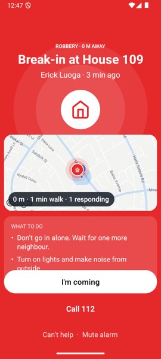
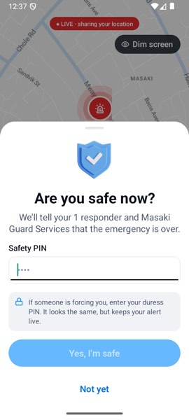

# NeighbourGuard — two-person demo test, 2026-11-07

_Erick = you@test.tz on the Android emulator (`qa_small`, Pixel-9 profile at 540×1200). Juma = juma@test.tz in
the browser preview (`expo start --web --port 8082`) because Xcode/Simulator.app is still not installed on this
Mac — decided at the start, not after 20 minutes. Backend `settings_local` on `http://172.30.1.77:8000`
(the Mac's LAN IP, written into `neighbour-mobile/.env`, not committed). Branch `rebuild/v2`._

## 1. Verdict

**Yes, with workarounds.** The demo path works end to end on both devices — after one P0 fix made today
(approved, committed on `rebuild/v2`, verified both ways). Two P1s on the path were also fixed and verified.
Workarounds that remain: build both phones with the venue IP in `.env`; Juma's seed account has no safety PIN
(his "I'm safe" needs no PIN — fine, or set one in Profile); and resolved alert cards are blank white blocks
in dark mode (keep phones in light mode).

## 2. Demo-path timings

| Run | Sender → responder | Release → server row | Release → Juma's socket gets the alert | Banner/push on responder | "I'm coming" → sender's screen | Homes alerted | Resolved on both |
|---|---|---|---|---|---|---|---|
| 1 (pre-fix) | Erick → Juma | <1 s | present when checked | in-app banner (no push on web) | ≤10 s (screen-poll resolution ~4 s) | 4 | **No** — Juma's chat stayed "LIVE" (the P0) |
| 2 (pre-fix) | Erick → Juma | 81 ms | **52 ms** card, 2.1 s summary | in-app banner | ≤9.9 s | 4 | No (same) |
| 3 (post-fix) | Erick → Juma | ~1 s | **180 ms** card, 2.3 s summary | in-app banner | ≤24 s measured while the emulator was under host load 17–50; the sender screen polls every 4 s (`POLL_MS`) | 4 | **Yes** — Juma's chat flipped by itself |
| 4 (reversed) | Juma (API) → Erick | — | — | Erick's Home banner **+6 s** (no push, in-app) | Juma's live screen showed "Help is on the way · Erick" when opened | — | **Yes** — Erick's chat flipped by itself |

Push never arrives in this setup (web has none; the emulator has no FCM credentials); the in-app banner on
Home carried every run. The screen-poll numbers are upper bounds: the server broadcast is sub-second, the
app's own polls are 4–5 s, and my uiautomator polling adds 2–20 s on a loaded host.

## 3. Findings (sorted)

### P0 (fixed today, commit a70c62a) · Neighbour's chat never showed "resolved" (or any alert update)
**Steps:** Erick SOS → Juma I'm coming → I've arrived (chat opens) → Erick I'm safe. **Expected:** Juma's chat
header and alert card show resolved. **Actual (runs 1–2):** "Live · 1 neighbours responding" and "LIVE ·
ROBBERY" forever. **Cause:** `chat/consumers.py` sent `{'type': 'alert_update', **payload}` and the payload's
own `'type': 'robbery'` overwrote the frame type; `lib/socket.ts:46` only reacts to `alert_update`. Captured
as Juma: `{"type":"medical","status":"resolved",…}`. **Fix:** `chat.services.alert_update_frame(payload,
viewer_id)` — duress mask first, kind under `alert_type`, `type` always `alert_update`, no `under_duress` key
for the sender; the consumer sends it. Unit-tested (3 tests, 21 chat tests green). **Verified:** run 3 (Juma's
web chat) and run 4 (Erick's Android chat) both flipped to resolved with no refresh.

### P1 (fixed today, commit 4de2199) · Sender's own live alert shown as a neighbour's
Home said "Robbery 0 m away · Erick Luoga · 1 responding · tap to help" for Erick's own alert, the tap did
nothing, and SOS opened the *neighbour* alarm ("Break-in at House 109 · I'm coming · Can't help") for his own
alert — no way back to "I'm safe" except a deep link. Now: "Your alert is live · tap to open" → `/sos/live`;
SOS while live → `/sos/live`; the alarm screen redirects the sender. Helpers `splitLiveAlerts` /
`routeForAlert` with jest tests (the app now has `npm test`, commit 5ad3fc4). Server already refuses a sender
responding to their own alert (existing test). 

### P1 (fixed today, commit ec740f6) · PIN sheet kept old digits; keypad covered "Yes, I'm safe"
Second attempt produced "12341234" (8 dots); the number pad hid the button. Now the sheet resets on open, a
complete 4-digit PIN submits itself (`pinAutoSubmits`, tested), and the sheet rides above the keyboard.
Verified in run 3: typing 1234 resolved with no further tap. Caveat: 5–8-digit PINs still need the button.

### P2 · Resolved alert cards are blank white blocks in dark mode
Juma's web chat (dark): every RESOLVED card is an empty white rectangle (text white-on-white); LIVE cards are
fine. `components/chat2/AlertCardBubble.tsx` resolved variant. Check a dark-mode phone; keep demo phones light.

### P2 · Text message from Android did not reach the server in two attempts (unconfirmed)
Juma's web text reached the server and Erick's Android in ≤24 s (socket). Erick's Android texts ("ping from
Erick", twice) never appeared in `chat/conversations/1/messages/`. Likely my automation (the first attempt
tapped the composer, the second came after a long idle); the app shows no failure state when a text cannot be
sent (yesterday's F-009 still open). **Retest by hand on a phone before the demo.**

### P2 (observation) · Home map fell back to "Map unavailable in this build" during the session
At 12:38 the live screen showed real Google tiles; at 13:28 Home said "No Google Maps key was set when it was
built". The key is in `.env` and in the manifest; `lib/maps.ts` reads a field Expo strips from the public
config (yesterday's note). The fix on `upgrade/expo-58` (`extra.hasMapsKey`) should be cherry-picked.

### P3 · Vouching twice is accepted (200, count unchanged) rather than refused
`POST places/residences/5/vouch/` as Juma: first → `{"status":"verified","vouches":2}`, second → same 200.
Idempotent, so harmless; the spec said "refused". An unverified user vouching was not tested (time).

### P3 · Issue comment posted by Juma (201) not counted in Erick's issue detail (`comments: 0`)
API-level only; may be a different endpoint/shape than I assumed. Check `issues/<id>/` comments on a phone.

### P3 · Copy: "Live · 1 neighbours responding"; "928 min ago" on old cards; web cluster chip "3 hon" clipped.

## 4. What passed (two devices unless marked API)
- Demo path ×3 + reversed (see table): hold → slide to Robbery → release; "4 homes alerted"; neighbour's Home
  banner; alarm screen (robbery copy, map, what-to-do); I'm coming → "Help is on the way · Juma Hassan" without
  refresh; I've arrived → chat with incident banner "You arrived at 12:37…"; I'm safe with PIN →
  "Everyone is safe" with the responder listed as Arrived; both devices resolved (post-fix).
- A. Real-time text: Juma → Erick arrived on Android without refresh (socket). Sheets: Android Back closes the
  attach sheet first, then leaves the chat. (Photo/location/voice/read-state/offline not done — time.)
- C. Neighbours list/profile: house numbers for verified viewers only; **no phone, no exact coordinates** in
  `places/neighbours/<id>/` (API) — matches the privacy rule.
- D. Vouching: Erick (seed) + Juma → Ritha became **verified** with `vouched_by` both names (API). Signing in
  as Ritha afterwards — not done (time).
- E. Medical notes: Juma sees `sender_medical` (skills, conditions, allergies, blood type) **only while live**;
  after resolve `sender_medical`, `sender_phone` and the exact home are all `None` (API).
- F. Can't help then a later `seen` → state stays `cant`; arrived stays arrived (API + run 3).
- G. Duress (API, post-fix frames): sender sees `resolved` with no `under_duress` key; sender's history says
  resolved; Juma sees `sent` + `under_duress: true`.
- H. Issue created by Erick → Juma supports → Erick sees `supports: 1`; share → issue card in the group chat.
- J. Notifications are per user: Juma's list is Erick's alerts; Erick's is Juma's alerts + welcome + provider.
- Server tests: `chat` 21/21; app: jest 4/4; `tsc` 0 errors.

## 5. Not tested, and why
iOS (Simulator.app absent → Juma on web): iOS swipe-back, push on iOS. Real push on either device. Photo,
location, voice note, read state and offline-then-online in chat; DMs (B); Fire/Medical alarm colours on the
device (API only); Ritha signing in after verification; unverified user vouching; check-in/witness arriving
on the other device (I); font scale; the keyboard on real phones. The usage pause from ~13:40 to ~16:10
cost the remaining sections.

## 6. Demo checklist for tonight
1. `.env`: `EXPO_PUBLIC_API_URL=http://<venue laptop IP>:8000`, `EXPO_PUBLIC_WS_URL=ws://<same>:8000`
   (today's Mac: `172.30.1.77`), then `npx expo prebuild --clean -p android` and `npx expo run:android` on both
   phones. Start the backend with `settings_local` and `seed_showcase`. Sign both phones in before going on stage.
2. Phones in **light mode**. Erick = you@test.tz (PIN 1234 set today), Juma = juma@test.tz (no PIN).
3. Erick: hold SOS → slide to Robbery → release. Say "4 homes alerted" (it is on screen).
4. Juma: push may not arrive — **tap the red banner on Home** ("Robbery 100 m away · tap to help"), then
   "I'm coming". Erick's screen shows "Help is on the way · Juma Hassan" within ~5 s. Do not go back to the
   alarm screen afterwards (it is harmless now, but there is nothing to see).
5. Juma: "I've arrived" → the group chat opens with the incident banner.
6. Erick: "I'm safe now" → type 1234 → it resolves itself. Both screens: "Everyone is safe" / card RESOLVED.
7. If Erick's phone ever drops to Home mid-alert: the banner now says "Your alert is live · tap to open".
8. If the chat card does not flip to resolved: the server was not restarted after pulling — restart `runserver`.
